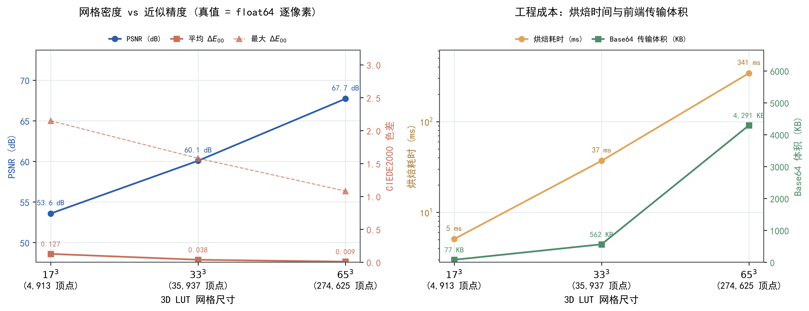
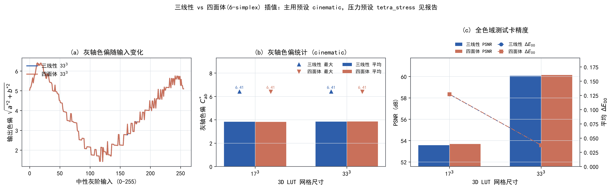

# AI Color Workbench

A local-first AI color-grading workbench that turns natural-language intent and 16 deterministic color parameters into portable 3D LUTs. The browser workbench combines WebGL2 preview, video playback, A/B comparison, color probing, a live RGB histogram and an interactive LUT volume. Python provides the API, intent providers, LUT math and media/export orchestration; a C++17 OpenGL worker provides an isolated off-screen image-render path.

> This repository contains both the current browser workbench and a Tkinter desktop client. They share Python color math and media services, while their preview paths differ. Browser Bloom is a spatial preview effect; the current API image/video exports accept parameter LUT settings and do not reproduce browser Bloom or an uploaded browser LUT. See [Known scope](#known-scope-and-measurement-notes).

## Highlights

- **Natural-language grading:** online DeepSeek JSON-mode requests with local schema validation and repair, plus a deterministic offline template/rule provider.
- **Deterministic color pipeline:** 16 bounded parameters, encoded-sRGB `sdr-srgb-v2` transforms, and 33³ preview / 33³ or 65³ exportable `.cube` LUTs.
- **Browser rendering:** WebGL2 3D LUT sampling, static-image mipmaps, real-time HTML video playback, adjustable strength, and a three-stage grade/Bloom/composite preview pipeline.
- **Comparison and analysis:** preview/original/split modes, hover and pinned color probes, a 17³ (4,913-point) LUT volume view, and a 64×64 off-screen RGB/luma histogram.
- **Media work:** image and video import, ffmpeg LUT-based video re-encoding, and a Tk desktop batch workspace for mixed image/video queues.
- **Isolated native renderer:** C++17, GLFW/GLAD and OpenGL 3.3+ off-screen FBO rendering over a bounded `ACRGBA01` file bridge.

## Screenshots from the five-dimension benchmark

These are the checked-in 300 DPI charts generated by the benchmark report. They describe the recorded benchmark runs, not current browser FPS.

### CPU reference and OpenGL worker timing


### LUT size, accuracy and payload



### Trilinear and tetrahedral interpolation



### Image-quality measurements


### Recorded highlights

The checked-in benchmark was generated on 2026-11-18 on Windows ARM64, Snapdragon 8cx Gen 3, with the recorded Mesa software OpenGL path. The 4K C++ worker `render_readback_ms` was **45.8 ms**; the benchmark's CPU-reference / render-readback ratio was **242.8×**. A full `EngineClient.render` call averaged **1,393.2 ms**, including process and file overhead, so 45.8 ms is not end-to-end latency or a browser frame time.

On the 64³ RGB probe, the 33³ LUT measured **60.069 dB PSNR** and **0.0376 mean ΔE00**, with a **561.5 KiB** base64 payload and **37.0 ms best-of-three bake time**. The offline provider scored **100% directional agreement** across the 24-command evaluation with **0.47 ms mean** measured provider latency. These values are specific to the checked-in inputs and run; online latency and output depend on network/model conditions.

See [`runtime/benchmark_results/benchmark_report.md`](runtime/benchmark_results/benchmark_report.md) and [`benchmark_raw.json`](runtime/benchmark_results/benchmark_raw.json) for method, samples, environment and full tables. The report's image set includes one fixture and five deterministic synthetic scenes.

## Architecture

```text
Browser: TypeScript DOM + WebGL2 ── REST / WebSocket ── FastAPI
          │                                             ├── ai/ intent providers
          ├── live image/video preview                  ├── baker/ color math + .cube
          ├── A/B, probe, histogram, LUT volume         ├── app/ image/video + job adapters
          └── spatial Bloom preview                     └── ffmpeg export

Tkinter desktop UI ── app/pipeline.py ── EngineClient ── one-shot C++ OpenGL worker
```

| Directory | Responsibility |
| --- | --- |
| `frontend/` | TypeScript workbench, WebGL2 viewport and LUT volume, UI components, API client, Vite configuration. |
| `api/` | FastAPI REST/WebSocket endpoints, media index, response envelope and in-process export jobs. |
| `ai/` | DeepSeek adapter, strict response parsing, offline templates/rules and prompt construction. |
| `baker/` | `ColorParams`, sRGB transform, 3D LUT generation, `.cube` parsing/writing and verification. |
| `app/` | Tkinter desktop client, shared image/video I/O, render pipeline, C++ worker client and batch queue. |
| `engine/` | C++17 request validation, `.cube` and RGBA bridge readers, GLFW/OpenGL renderer. |
| `shaders/` | Native renderer's OpenGL GLSL full-screen vertex and LUT-grade fragment shaders. Browser shaders are currently embedded in `frontend/src/core/gl_viewport.ts`. |
| `tools/` | Five-dimension benchmarks, stage acceptance scripts, configuration and scale checks. |
| `tests/` | Python unittest coverage for color math, API, media, queues, session, LUT, renderer protocol and video. |
| `runtime/benchmark_results/` | Checked-in raw benchmark evidence, reports and charts. Generated jobs, caches, uploads and logs are ignored. |

## Local quick start

### 1. Python environment and AI configuration

Windows PowerShell, from the repository root:

```powershell
python -m venv .venv
.\.venv\Scripts\python.exe -m pip install -r requirements-lock.txt
Copy-Item .env.example .env
# Optional: edit .env and set AI_API_KEY for online DeepSeek requests.
```

Without an API key the provider factory uses the offline intent provider. Keep `.env` local; `.env.example` contains placeholders only.

### 2. Build the native render worker

The project uses CMake 3.20+, a C++17 compiler, GLFW 3 and the GLAD sources/headers referenced by `CMakeLists.txt`. The repository's configured Windows setup uses Visual Studio 2022 ARM64 and vcpkg. Set the vcpkg toolchain path for your machine:

```powershell
cmake -S . -B build-arm64 -G "Visual Studio 17 2022" -A ARM64 `
  -DCMAKE_TOOLCHAIN_FILE="C:/path/to/vcpkg/scripts/buildsystems/vcpkg.cmake" `
  -DVCPKG_TARGET_TRIPLET=arm64-windows-static-md `
  -DGLAD_INCLUDE_DIR="C:/path/to/glad/include"
cmake --build build-arm64 --config Debug
```

CMake locates GLFW through the vcpkg toolchain and takes the generated GLAD header directory through `GLAD_INCLUDE_DIR`; set both paths to locations on your machine. The worker is searched under `build-arm64/Debug`, `build-arm64/Release` and `build/Debug`, or can be selected with `AI_COLOR_WORKER`. Its adjacent `shaders/` directory is copied by the post-build rule. On the documented local Mesa setup, runtime DLLs such as `opengl32.dll` and `dxil.dll` must also be available beside the worker.

### 3. Start the browser workbench

In one PowerShell window, start FastAPI:

```powershell
.\.venv\Scripts\python.exe -m uvicorn api.server:app --host 127.0.0.1 --port 8765
```

In a second window:

```powershell
cd frontend
npm ci
npm run dev
```

Open <http://localhost:5173>. The Vite dev server proxies `/api` and `/ws` to `127.0.0.1:8765`. Alternatively, from the project root run `./start_web.ps1`; it installs frontend dependencies if `frontend/node_modules` is absent and starts the two services in separate PowerShell windows.

### Desktop client

Build the native worker as above, then from the project root run:

```powershell
./run.ps1
```

The worker is required for desktop image preview/export. Video support additionally uses `ffprobe` and `ffmpeg`; set `AI_COLOR_FFPROBE` / `AI_COLOR_FFMPEG` if they are not on `PATH`.

## Checks and reproducibility

```powershell
.\.venv\Scripts\python.exe -m unittest discover -s tests -q
cd frontend
npm run build
cd ..
.\.venv\Scripts\python.exe tools\run_benchmark.py
```

The five-dimension benchmark writes under `runtime/benchmark_results/`. It performs CPU/worker timing, LUT accuracy and size, interpolation comparisons, image-quality measurements, and offline intent evaluation. `--online` additionally calls the configured online provider and requires a valid API key; it is not needed to reproduce the offline results. Benchmark runs can take several minutes and replace the generated raw report/chart files.

## Known scope and measurement notes

- The browser video preview uses an `HTMLVideoElement` and WebGL2 animation loop. The Tk desktop video path extracts frames for its timeline preview. Do not treat the benchmark's native worker timing as browser FPS.
- Browser Bloom is a spatial, preview-side post-effect. It is not part of a pointwise `.cube` LUT. Current API exports accept parameters and strength; they do not accept the browser's Bloom value or external-LUT payload. The browser and those export paths therefore do not promise identical output for those modes.
- Browser color probing reports source and LUT-graded RGB and can pin a sample location for the LUT volume view; it is a readout/visualization, not a control that edits color parameters.
- The recorded stage-seven matrix is dated 2026-11-20 and has several video/manual items marked as skipped or backed by other tests. See [`STAGE7_ACCEPTANCE_REPORT.md`](docs/STAGE7_ACCEPTANCE_REPORT.md); “18/18” should be read with those evidence notes.
- The checked-in charts and measurements are historical run artifacts, not claims about every GPU, browser, image, video or current build. OpenGL worker output is 8-bit RGBA readback; PNG is a lossless file encoding, but the grading pipeline is not mathematically lossless relative to the original.

## License and third-party notices

See [`docs/THIRD-PARTY.md`](docs/THIRD-PARTY.md) for dependency and generated GL loader notices. No project license file is currently included.
