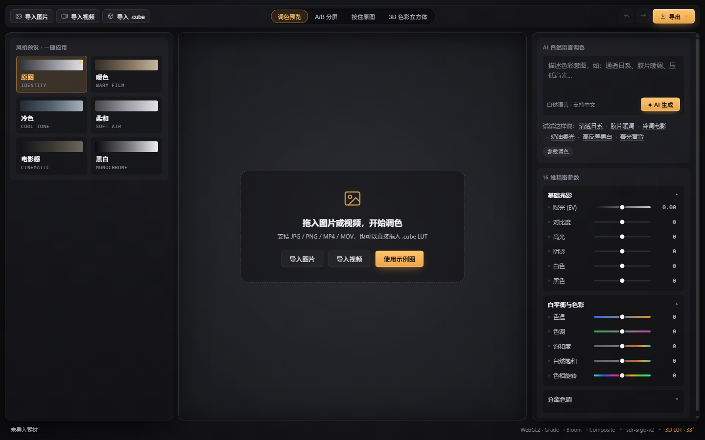
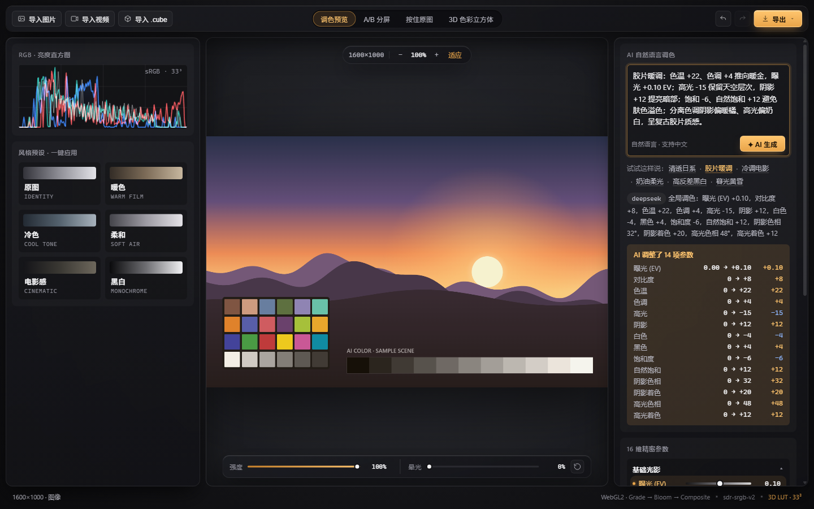
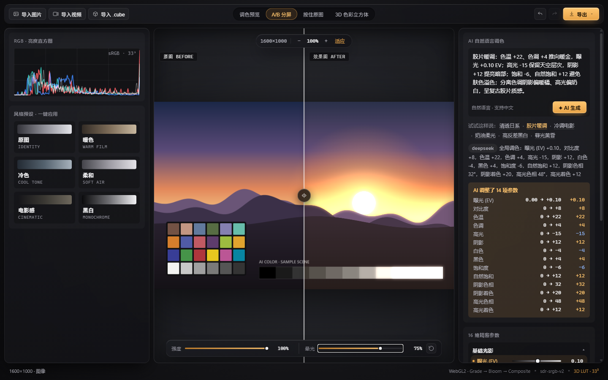
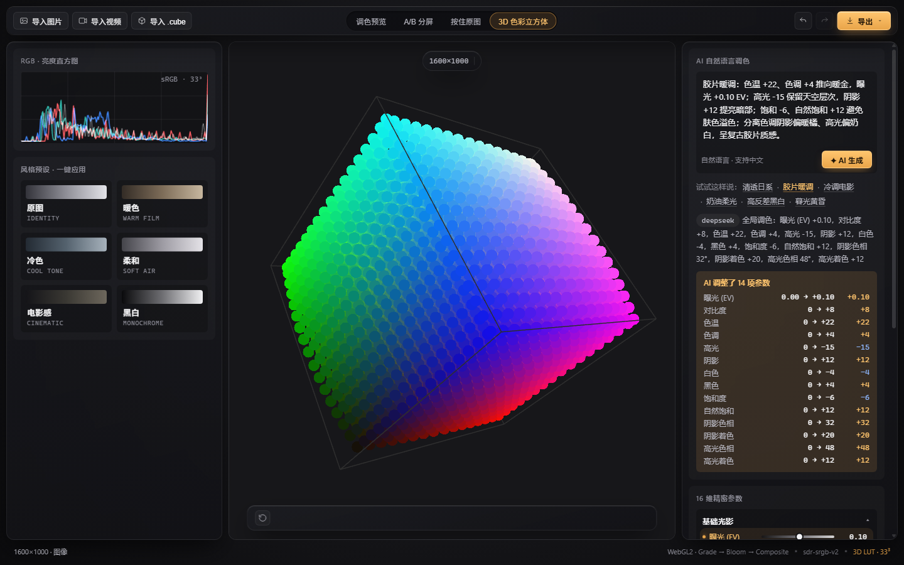
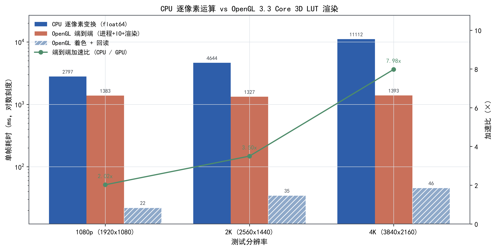
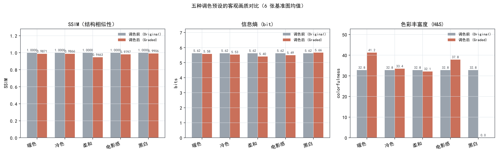

# AI Color Workbench · 智能调色工作台

一套面向图像与视频的本地优先调色工作台：自然语言负责表达调色意图，受约束的 16 维参数负责承载可解释修改，确定性色彩变换将参数烘焙为可复用的 3D LUT。浏览器端以 WebGL2 提供交互预览，Python/FastAPI 负责 AI、LUT 与媒体任务，C++17/OpenGL worker 提供桌面端离屏图像渲染能力。

项目让 AI 改变“如何表达调色”。参数、预设和 LUT 都可以检查或调整；图像与视频导出仍由传统色彩变换管线完成。

## 一、选题背景与项目定位

专业调色软件提供精确、可重复的色彩控制，但参数之间相互影响，初学者需要理解曝光、影调、白平衡和分离色调等概念。简单滤镜易用，却通常难以解释和逐项调整；生成式图像编辑则可能改变原图细节，也不适合要求帧间稳定的视频调色。

本项目尝试把自然语言交互与传统图形学调色结合起来：用户描述想要的色彩方向，在线模型或本地规则解析器给出有边界的参数修改，Python 调色器把参数确定性地转换为 3D LUT，浏览器进行实时预览，媒体导出沿既有 LUT/FFmpeg 路径执行。这样既降低了操作门槛，也保留参数可读、结果可复现的工作方式。

## 二、设计思路与工程权衡

### 自然语言到参数，而不是直接生成像素

在线 DeepSeek provider 负责解析较复杂的意图；未配置在线服务时，provider 工厂可以使用本地离线模板与规则解析。输出经过解析、结构校验和参数范围约束，再进入调色状态。前端会列出 AI 调整前后的参数差异，用户也可以继续用滑杆细调。

### 以 3D LUT 连接调色数学与渲染

`baker/` 中的 `ColorParams` 和色彩变换实现构成参数与 LUT 的核心。当前浏览器预览使用 33³ LUT，导出路径支持 33³ / 65³ `.cube` LUT。浏览器的 3D 纹理采样、C++ OpenGL worker 与 FFmpeg `lut3d` 各自消费 LUT 或参数生成的 LUT，使色彩变换能跨路径复用。

LUT 的优势是运行时查表简单、便于交换与复用；它也有明确边界：点对点 RGB 映射无法表示依赖周围像素的空间效果。因此浏览器 Bloom 属于预览后处理，不会自动包含在 `.cube` 或当前 API 媒体导出中。

### 色彩变换与交互预览

调色器按代码中定义的 `sdr-srgb-v2` 流程处理 16 个有界参数，涵盖基础光影、白平衡与色彩、分离色调。静态图片预览使用 mipmap 降低缩小时的混叠；视频预览使用 HTML video 帧更新纹理。WebGL2 视口支持效果预览、原图查看、A/B 分屏、缩放与平移；另有直方图、颜色取样和 17³ 点的 LUT 体积视图。

## 三、系统架构与目录职责

```text
浏览器：TypeScript / WebGL2 ── REST / WebSocket ── FastAPI
        ├─ 图片与视频预览、A/B、取样、直方图、LUT 体积       ├─ ai/ 自然语言解析
        └─ Bloom 屏幕空间预览                               ├─ baker/ 色彩变换与 .cube
                                                           └─ app/ 媒体与任务适配

Tkinter 桌面端 ── app/pipeline.py ── EngineClient ── C++17 / OpenGL worker
浏览器视频导出 ── API / FFmpeg lut3d ── 输出文件
```

| 目录 | 职责 |
| --- | --- |
| `frontend/` | TypeScript 工作台、Vite 配置、WebGL2 视口、LUT 体积视图、交互组件与 API 客户端。浏览器着色器包含在 `frontend/src/core/gl_viewport.ts`。 |
| `api/` | FastAPI REST 与 WebSocket 接口、媒体索引、响应封装和导出任务编排。 |
| `ai/` | 在线 DeepSeek 适配、本地离线意图解析、provider 调度和提示构造。 |
| `baker/` | 16 维参数模型、色彩变换、LUT 烘焙、`.cube` 读写与校验。 |
| `app/` | Tkinter 桌面客户端、图像/视频 I/O、共享 pipeline、作业队列和 C++ worker 客户端。 |
| `engine/` | C++17 请求校验、LUT 与 RGBA 桥接、GLFW/OpenGL 离屏渲染。 |
| `shaders/` | 原生 worker 使用的 GLSL 顶点与片元着色器。 |
| `tools/` | 基准测试、阶段验收与项目检查工具。 |
| `tests/` | Python 自动化测试，覆盖参数、LUT、AI、API、媒体、任务队列与渲染协议等。 |
| `runtime/benchmark_results/` | 已归档的原始基准数据、报告和图表。运行缓存、上传及导出文件不属于这些测评证据。 |

## 四、实际界面与核心交互

以下截图来自本地运行的浏览器工作台，窗口尺寸为 1440×900。

| 空状态引导 | AI 调色与参数差异 |
| --- | --- |
|  |  |
| 空状态提供导入与内置示例入口。 | 示例场景运行“胶片暖调”后，右侧列出本次 14 项参数变化。 |

| Bloom 与 A/B 分屏 | 3D 色彩立方体 |
| --- | --- |
|  |  |
| 画面展示 75% 晕光设置及原图/效果图分屏。Bloom 是预览侧的空间后处理。 | 点云视图展示输入 RGB 立方体经 LUT 映射后的颜色分布；取样映射标注可由 2D 视口的 Shift+点击交互触发。 |

## 五、五维实验与性能记录

仓库保留了五类测评的图表和原始数据：OpenGL worker 与 CPU 参考实现计时、LUT 网格精度与体积、三线性/四面体插值比较、多场景图像质量指标、离线中文意图解析结果。下列图表来自已归档测评运行；它们不是对所有设备或输入的性能承诺。

### OpenGL worker 与 CPU 参考计时



### LUT 网格精度与数据体积


### 三线性与四面体插值


### 测试图像质量指标



归档运行记录于 2026-11-18 在 Windows ARM64 / Snapdragon 8cx Gen 3 环境完成，OpenGL 路径为记录中的 Mesa 软件 OpenGL。4K C++ worker 的 `render_readback_ms` 为 **45.8 ms**；以 CPU 参考实现耗时除以该回读计时得到 **242.8×**。一次完整 `EngineClient.render` 平均为 **1,393.2 ms**，包含进程和文件开销，因此上述 45.8 ms 不代表端到端延迟或浏览器实时帧率。

在 64³ RGB 探针上，33³ LUT 记录为 **60.069 dB PSNR**、平均 **0.0376 ΔE00**；LUT base64 数据为 **561.5 KiB**，三次烘焙中最佳耗时 **37.0 ms**。离线 provider 在 24 条命令评估中的方向一致率为 **100%**，记录的平均 provider 延迟为 **0.47 ms**。这些数字仅描述对应测评输入和环境。

完整方法、样本和数据见 [`benchmark_report.md`](runtime/benchmark_results/benchmark_report.md) 与 [`benchmark_raw.json`](runtime/benchmark_results/benchmark_raw.json)。报告使用一张固定样例与五类确定性合成场景。阶段七验收记录及其证据范围见 [`STAGE7_ACCEPTANCE_REPORT.md`](docs/STAGE7_ACCEPTANCE_REPORT.md)。

## 六、本地运行与构建

### Python 环境与配置

在仓库根目录的 PowerShell 中执行：

```powershell
python -m venv .venv
.\.venv\Scripts\python.exe -m pip install -r requirements-lock.txt
Copy-Item .env.example .env
# 如需在线 DeepSeek 服务，在本地 .env 中填写 AI_API_KEY；不要提交该文件。
```

未配置密钥时，provider 工厂使用离线意图解析。`.env.example` 仅用于说明配置项。

### 启动浏览器工作台

先在一个 PowerShell 窗口启动后端：

```powershell
.\.venv\Scripts\python.exe -m uvicorn api.server:app --host 127.0.0.1 --port 8765
```

再开另一个窗口启动前端：

```powershell
Set-Location frontend
npm ci
npm run dev
```

访问 <http://127.0.0.1:5173/>。Vite 将 `/api` 和 `/ws` 请求转发给本机 8765 端口。也可按项目脚本说明使用仓库根目录的 `start_web.ps1`。

### 构建 C++ worker、桌面端与验证

原生 worker 使用 CMake 3.20+、C++17、GLFW 与 GLAD，OpenGL 要求至少 3.3。Windows 配置需安装 Visual Studio 2022 C++ 工作负载、vcpkg 中的 GLFW，以及一份生成的 GLAD 头文件。按本机实际路径修改下面的工具链与 GLAD 路径：

```powershell
cmake -S . -B build-arm64 -G "Visual Studio 17 2022" -A ARM64 `
  -DCMAKE_TOOLCHAIN_FILE="C:/path/to/vcpkg/scripts/buildsystems/vcpkg.cmake" `
  -DVCPKG_TARGET_TRIPLET=arm64-windows-static-md `
  -DGLAD_INCLUDE_DIR="C:/path/to/glad/include"
cmake --build build-arm64 --config Debug
```

GLAD 目录需要包含 `glad/glad.h`；CMake 通过上述 toolchain 查找 GLFW。worker 会在程序旁放置 `shaders/` 目录。构建后可运行 `./run.ps1` 启动桌面端；桌面视频能力还需要 `ffprobe` / `ffmpeg`。

运行自动化检查：

```powershell
.\.venv\Scripts\python.exe -m unittest discover -s tests -q
Set-Location frontend
npm ci
npm run build
```

自动化测试数量随仓库版本变化；运行命令会报告当前实际结果。需要重现五维测评时，可运行 `tools/run_benchmark.py`；测评运行可能耗时数分钟，并会更新 `runtime/benchmark_results/` 中生成的报告和图表。在线 AI 测评需要有效配置及网络连接。

## 七、已知边界与后续方向

- 浏览器 Bloom 是空间型预览后处理，不属于点对点 `.cube` 映射；当前 API 图像/视频导出也不接收浏览器 Bloom 值或外部 LUT，因此不同预览/导出路径不承诺这些模式下像素完全一致。
- 浏览器视频预览使用 `HTMLVideoElement` 和 WebGL2 动画循环；桌面视频路径使用时间线帧预览。原生 worker 的基准计时不能作为浏览器 FPS 指标。
- 颜色取样用于读取原色与 LUT 映射色，并在 LUT 体积视图中显示空间位置关系；它不会反向修改参数。
- 阶段七验收矩阵日期为 2026-11-20，部分视频/实机条目标注为跳过或由其他测试佐证。阅读验收结论时应同时查看其证据说明。
- 原生 worker 通过 8-bit RGBA 回读；PNG 文件编码无损不等于调色管线相对输入像素数学无损。
- 后续可继续完善静态画面的按需重绘、浏览器与导出效果的一致性，以及批量媒体操作和工作流体验。
