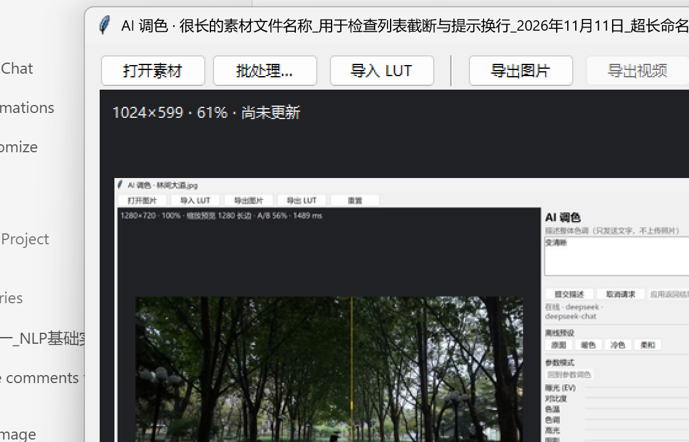
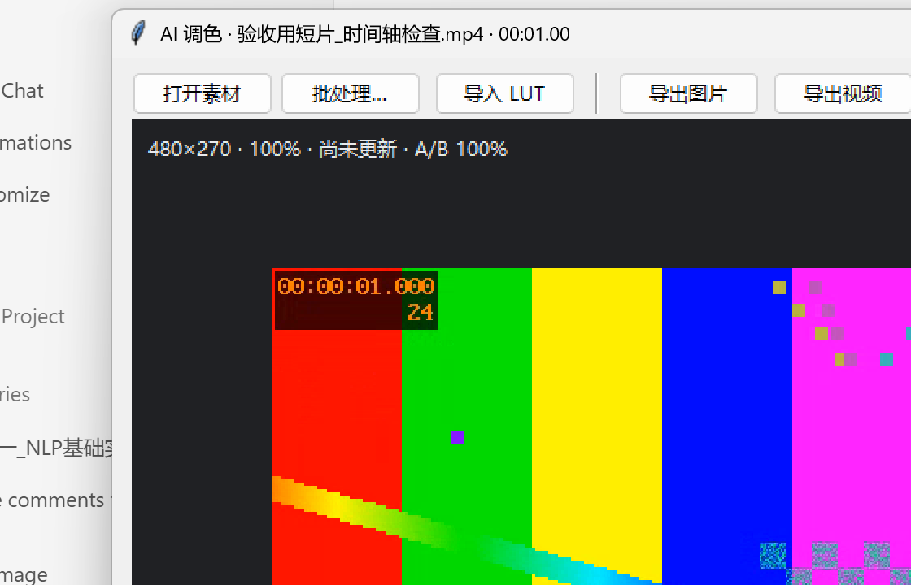

# 2026-11-11 UI 人工验收清单（单素材 + 批次窗口）

对应《开发指导》§3.1 与 §7“UI 与可用性”。范围由用户确认：高 DPI、最小窗口、
长文件名、视频条与 A/B、批次全流程。自动化只能测几何与状态，**观感与可用性仍需
人工判定**，本文件给出可复现步骤与勾选表。

## 0. 环境与准备

```
# 已完成（本机 100% 缩放）
.\.venv\Scripts\python.exe runtime\ui_acceptance_check.py --keep-artifacts
```

脚本自动创建：超长文件名图片（`很长的素材文件名称_…编号0123456789.jpg`）、
超长输出目录、2 秒测试视频（含中文名），并在最小窗口下测量控件几何、驱动时间轴
与 A/B、跑完两项批处理。输出截图默认随临时目录删除，加 `--keep-artifacts` 保留。

本次记录的界面截图保存在 `docs/test-runs/evidence/2026-11-11-ui-acceptance/`。其中批处理长文件名截图显示了本机临时目录路径，为保护隐私不随公开仓库分发；本地原图未删除。





批处理窗口布局见 [`05-batch-window-fixed.png`](evidence/2026-11-11-ui-acceptance/05-batch-window-fixed.png)；原长文件名截图因含本机临时路径未公开。

## 1. 自动化已覆盖（本次结果）

| 检查 | 结果 |
| --- | --- |
| 最小窗口：工具栏子控件不越界、互不重叠 | 通过 |
| 最小窗口：侧栏滚动条可见、内容溢出、可滚动 | 通过 |
| 最小窗口：直方图不被窗口底部裁掉、对比行在画布下方 | 通过 |
| 长文件名：加载、标题显示、导出到长路径、完成提示含素材名 | 通过 |
| 视频：时间轴可见、跳到中段后画面更新、时间轴宽度可用 | 通过 |
| A/B：`split_t` 生效与恢复，分割时可重绘 | 通过 |
| 批次：长名两项跑完、输出保留长主名、列宽总和不再超出窗口 | 通过 |
| 批次：列表新增横向滚动条（列超宽时可达） | 通过 |

## 2. 待人工判定

### 2.1 高 DPI（125% / 150%）

1. Windows 设置 → 系统 → 显示 → 缩放，改为 125%，重启应用。
2. 打开一张图片和一段视频，滚动侧栏到最底部；调整窗口到最小尺寸再还原。
3. 重复 150%。

预期：字号随缩放变大但不互相覆盖；工具栏按钮不换行、不被裁切；侧栏滚动条宽度
正常；直方图与对比行仍完整；批次窗口的列表与两行按钮不重叠。

> 自动化不模拟 DPI：`tk scaling` 只改字体度量，不能替代真实显示缩放。

- [ ] 125%：主窗口布局正常
- [ ] 125%：批次窗口布局正常
- [ ] 150%：主窗口布局正常
- [ ] 150%：批次窗口布局正常

### 2.2 最小窗口与侧栏滚动

1. 把主窗口拖到最小（当前约 1120×700 × 缩放系数）。
2. 滚轮在侧栏不同区域滚动，检查“曲线/HSL 等折叠区”是否都能到达。

预期：无控件重叠；侧栏可滚到底；预览画布与直方图按比例压缩而非消失。

- [ ] 侧栏可滚到最底部
- [ ] 画布、直方图、对比行不重叠
- [ ] 批次窗口在 860×520 最小尺寸下列表仍可滚动

### 2.3 长文件名 / 长路径

1. 打开 `很长的素材文件名称_…编号0123456789.jpg`。
2. 导出到超长目录，观察完成提示与窗口标题。
3. 在批次窗口导入同一文件，观察列表“素材”列与“说明/输出”列。

预期：标题与提示完整包含素材名；列表长名被裁切时可横向滚动查看（Treeview 不做
省略号，这是已知限制）；输出文件名保留长主名。

- [ ] 长名在标题/提示中可辨认
- [ ] 列表裁切时可用横向滚动查看完整名
- [ ] 输出文件保留长主名

### 2.4 视频时间轴与 A/B

1. 打开视频，拖动时间轴到 30%/70%，等待画面更新。
2. 勾选“A/B 对比”，拖动分割线到 50%，再拖回 100%。
3. 按住“按住查看原图”，观察原图/效果切换。

预期：进度条拖动后画面在约 0.2–0.5 s 内更新；分割线跟随指针；状态栏显示 A/B 百分比；
按住原图时画面切换且标题时间码不跳变。

- [ ] 时间轴拖动响应正常
- [ ] A/B 分割线拖动与百分比一致
- [ ] 按住原图可用

### 2.5 批次全流程

1. 打开批次窗口，导入 1 张图 + 1 段视频，选输出目录，开始。
2. 运行中观察：主窗口导出按钮与“打开素材”是否禁用、批次状态栏计数。
3. 点“取消后续”，再开一批点“取消当前项”，最后开一批直接关窗口。
4. 重试一个失败项（可先删除源文件制造失败），确认重试后仍报同一错误。

预期：同一时刻只有一个重型任务；取消后状态为“已取消”而不是“已完成”；关闭确认
汇总剩余项；取消清理后不残留半成品；失败项不阻断后续。

- [ ] 主窗口互锁生效并在结束后恢复
- [ ] 取消后续保留当前项
- [ ] 取消当前项后无半成品
- [ ] 关闭确认与清理行为符合预期
- [ ] 失败项可重试且原因可读

## 3. 本次发现的已知限制

- `ttk.Treeview` 不提供省略号，超长素材名会被裁切；已加横向滚动条，默认列宽总和
  （934 px）在默认窗口（约 975 px 列表宽）内不再溢出。
- 长路径导出依赖 Windows 长路径支持；脚本在系统临时目录下通过，但极深目录仍可能
  被平台拒绝，错误会以逐项错误显示。
- 批次窗口没有独立单项滑块面板，参数操作只有“用当前参数填充所选/恢复统一参数”。

## 4. 记录

| 项目 | 结论 | 备注 |
| --- | --- | --- |
| 125% DPI | 待填 | |
| 150% DPI | 待填 | |
| 最小窗口 / 侧栏滚动 | 待填 | |
| 长文件名 / 长路径 | 待填 | |
| 视频时间轴 / A/B | 待填 | |
| 批次全流程 | 待填 | |

## 5. 2026-11-11 深灰工作台改造后的复验（自动）

改造内容见 `docs/decisions/ADR-011-dark-workbench-ui.md`。本节只记录证据。

### 5.1 自动检查

```
python -m unittest discover -s tests -q            -> Ran 204 tests, OK
python runtime/ui_layout_check.py                  -> 无溢出（page0_overflow 0）
python runtime/ui_acceptance_check.py              -> OK
python runtime/batch_ui_check.py                   -> OK
python runtime/batch_mixed_check.py                -> OK（4 阶段：混合、缺失源、取消后续、取消当前）
python runtime/ui_export_queue_check.py            -> OK
python runtime/ui_video_check.py                   -> OK
python runtime/ui_stress_check.py                  -> OK（4 阶段 15 项 PASS）
python runtime/ui_theme_check.py --scale 1.0       -> OK
python runtime/ui_theme_check.py --scale 1.25      -> OK
python runtime/ui_theme_check.py --scale 1.5       -> OK
python runtime/ui_theme_check.py --scale 2.0       -> OK（本机实际缩放）
```

`ui_theme_check.py` 断言：8 组前景/背景对比度、工具栏子控件不越界不重叠、素材字段
被省略但 tooltip 保留完整路径、侧栏可滚且内容不超宽、直方图不与对比行重叠、四个
状态字段可见、最小窗口下直方图不被裁切且预览画布 ≥ 180 px、Tab 顺序至少 4 站、
批次窗口 860×520（× 缩放）下按钮不越界、列表行高 ≥ 缩略图、状态与素材名非空、
参数读数随“已修改/默认”切换 `Value.TLabel` / `ValueZero.TLabel`。

导出结果文案由 `ui_export_queue_check.py` 与 `ui_video_check.py` 断言包含素材名、类型、
rev 与输出路径（视频路径提交 token 后，`视频导出完成（clip.mp4，rev 2）：…`）。

### 5.2 缩放矩阵（模拟 `tk scaling`）

| 显示缩放 | 主窗口 | 工具栏内容 / 宽度 | 画布 | 侧栏 | 批次最小窗口 | 列表列宽 / 可视宽 |
| --- | --- | --- | --- | --- | --- | --- |
| 100% | 1440×900 | 1428 / 1440 | 981×650 | 400×748，内容 1041 | 860×520，树 817×143 | 980 / 817（横向滚动） |
| 125% | 1800×1125 | 1785 / 1800 | 1230×823 | 500×945，内容 1198 | 1075×650，树 1032×213 | 1223 / 1032 |
| 150% | 2160×1350 | 2142 / 2160 | 1480×992 | 600×1139，内容 1391 | 1289×779，树 1246×265 | 1470 / 1246 |
| 200% | 2496×1472 | 2472 / 2496 | 1595×1006 | 800×1202，内容 1735 | 1718×1039，树 1675×384 | 1959 / 1675 |

### 5.3 截图

- `runtime/screenshots/main-live.png`（当前 200% 桌面，含深色标题栏、预览、侧栏、四状态字段）
- `runtime/screenshots/batch-live.png`（批次窗口，2 项，状态列与页脚计数）
- `runtime/screenshots/main-100.png` / `main-125.png` / `main-150.png` / `main-200.png`（PrintWindow，仅客户区）
- `runtime/screenshots/batch-100.png` / `batch-125.png` / `batch-150.png` / `batch-200.png`

复现：`python runtime/ui_theme_check.py --scale 1.25`、
`python runtime/capture_ui.py --tag live`（后者会短暂置顶窗口）。

### 5.4 仍需人工判定

- [ ] 在真实 125% / 150% 显示器上看一眼：字号、按钮文字、下拉框箭头是否清晰
- [ ] 键盘 Enter/Space 触发按钮、Tab 焦点环是否足够明显（自动化只验证焦点顺序与样式映射）
- [ ] 主观观感：预览是否仍是视觉中心，UI 是否不干扰色彩判断
- [ ] 视频批次运行中的“当前项/剩余/失败”读数是否符合预期
- [ ] 导出失败（只读目录/磁盘满）时的提示与重试路径


