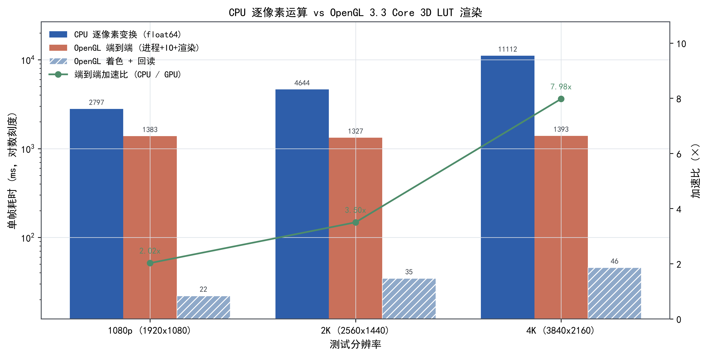
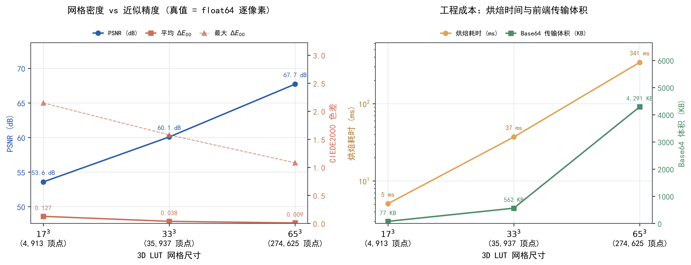
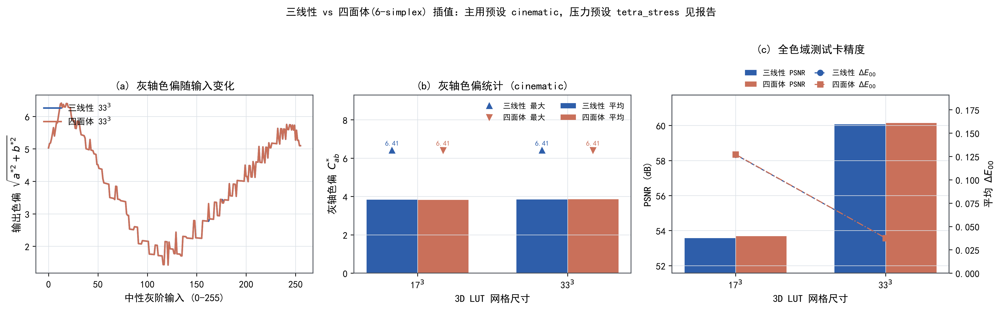
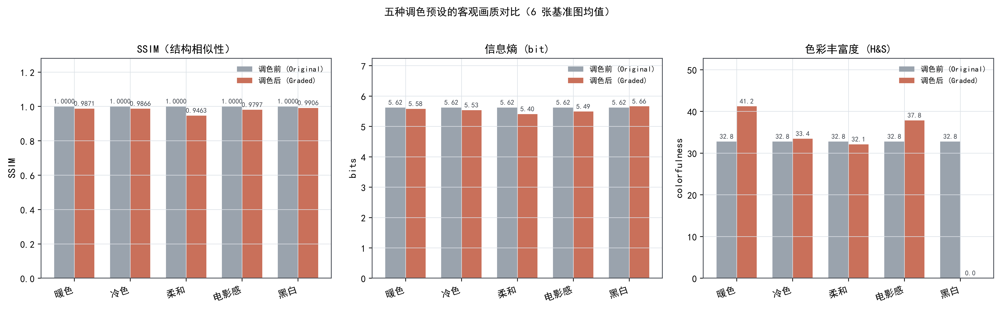

# AI 智能调色工作台 · 五维性能与图像质量 Benchmark 报告

> 本报告由 `tools/run_benchmark.py` 全自动生成，原始采样数据见 `benchmark_raw.json`。评测脚本只读现有业务模块，不修改 `baker/ engine/ ai/ api/ frontend/` 下任何代码。

## 1. 实验环境与可复现性

| 项目 | 值 |
|---|---:|
| 生成时间 | 2026-11-18 13:35:45 |
| 操作系统 | Windows-11-10.0.26200-SP0 |
| CPU | Snapdragon (TM) 8cx Gen 3 @ 3.0 GHz |
| GPU / 渲染后端 | Virtual Display Device · OpenGL 3.3 Core (offscreen FBO, Mesa software rasteriser) |
| Python | 3.13.12 |
| numpy / matplotlib / Pillow | 2.5.4 / 3.11.2 / 13.0.0 |
| 算法版本 | sdr-srgb-v2 |
| 渲染 worker | `build-arm64\Debug\render_worker.exe`（1,235,456 B，2026-10-20 13:09:38） |
| 采样策略 | 每种配置预热 1 次 + 连续测量 5 次，报告均值与 P95 |

所有指标均在单机、单进程串行执行，未开启后台负载。颜色度量使用自实现的 sRGB→XYZ(D65)→CIELAB 与 CIEDE2000 公式，未引入 OpenCV/scikit-image 依赖。

说明：本机为 ARM64 移动平台，CPU 长时满载会触发温控降频，同一配置跨轮次的均值波动可达 ±10%；表内 P95 与加速比均来自同一轮连续采样，跨轮次对比请以 `benchmark_raw.json` 中的样本序列为准。

## 2. 结论摘要

- OpenGL 3D LUT 管线的端到端加速比从 1080p (1920x1080) 的 2.02× 提升到 4K (3840x2160) 的 7.98×；若只计着色与回读阶段，加速比达到 242.8×，说明瓶颈已经从像素运算转移到进程与 I/O 开销。
- 33³ LUT 的 PSNR 为 60.07 dB、平均 $\Delta E_{00}$ = 0.038，已在视觉无损区间；65³ 再把 PSNR 提高 7.64 dB（均值 $\Delta E_{00}$ 0.038 → 0.009），但传输体积要涨到 7.6×，而 33³ 的误差已低于可辨阈值。
- 五种预设的调色后 SSIM 均在 0.946 以上；mono 把色彩丰富度从 32.8 压到 0.0，符合黑白风格的预期。
- AI 意图解析（离线模板+规则）一次通过率 100.0%、方向一致性 100.0%、均值延迟 0.47 ms；在线 deepseek/deepseek-flash 方向一致性 100.0%、均值延迟 1886 ms，与离线规则引擎持平，但单次延迟高 3980 倍。
- 最值得优化的三项：渲染进程冷启动主导低分辨率端到端耗时；CPU 参考路径不具备实时性；高密度 LUT 的传输体积增长快于可感知精度收益。

## 3. 维度一：OpenGL GPU 渲染管线加速比

被测参数集为 `cinematic`，LUT 尺寸 33³。CPU 侧为 `transform_rgb` 的 float64 逐像素全参数实现；GPU 侧每个样本都是一次完整的 `EngineClient.render`（新进程 → GL 上下文 → 上传 RGBA → 片元着色 → `glReadPixels`）。

| 分辨率 | MP | CPU 均值 (ms) | CPU P95 (ms) | GPU 端到端 (ms) | GPU P95 (ms) | GPU 着色+回读 (ms) | 进程/IO 开销 (ms) | 端到端加速比 | 纯着色加速比 |
|---|---:|---:|---:|---:|---:|---:|---:|---:|---:|
| 1080p (1920x1080) | 2.07 | 2797.3 | 2804.4 | 1383.4 | 1510.9 | 22.0 | 1361.4 | **2.02×** | 126.9× |
| 2K (2560x1440) | 3.69 | 4643.8 | 4938.4 | 1326.9 | 1406.3 | 34.7 | 1292.2 | **3.50×** | 134.0× |
| 4K (3840x2160) | 8.29 | 11112.1 | 11198.1 | 1393.2 | 1420.4 | 45.8 | 1347.4 | **7.98×** | 242.8× |



**读数**：端到端加速比随分辨率上升而增长，因为固定的进程启动成本被摊薄；
纯着色阶段（`metrics.render_readback_ms`）才是 GPU 的真实吞吐，它比端到端数字高一个数量级。

## 4. 维度二：3D LUT 尺寸近似精度与色差

预设 `cinematic`，真值为 float64 逐像素变换，探针为 64^3 RGB lattice (512x512)，采样方式为 trilinear (GPU-equivalent)。色差基于 8-bit 量化后的输出计算（即用户实际看到的像素）。

| 尺寸 | 顶点数 | PSNR (dB) | MAE (/255) | 最大绝对误差 | ΔE76 均值 / 最大 | ΔE00 均值 / P95 / 最大 | 烘焙 (ms) | Base64 (KB) |
|---|---:|---:|---:|---:|---:|---:|---:|---:|
| 17³ | 4,913 | 53.57 | 0.200 | 4 | 0.260 / 2.64 | 0.127 / 0.510 / 2.15 | 5.1 | 77 |
| 33³ | 35,937 | 60.07 | 0.054 | 2 | 0.077 / 1.95 | 0.038 / 0.297 / 1.58 | 37.0 | 562 |
| 65³ | 274,625 | 67.71 | 0.011 | 1 | 0.017 / 1.45 | 0.009 / 0.000 / 1.08 | 341.3 | 4,291 |



注：`ΔE00 P95 = 0.000`（65³）表示 95% 以上的像素在 8-bit 量化后与真值完全一致，并不代表统计错误；剩余误差集中在极暗部，那里 1/255 的量化台阶即可放大到 ΔE00 > 1。

**工程结论**：33³ 的平均色差已进入视觉无损区间（$\Delta E_{00}$ 均值 0.038、P95 0.297），把预览固定在 33³、仅在最终导出升到 65³（均值 0.009），是精度与传输体积之间的最优折中。

## 5. 维度三：三线性 vs 四面体（6-simplex）插值

灰轴使用 0-255 共 256 级中性灰输入，全色域使用 64^3 RGB lattice。主用预设 `cinematic`，并额外加入一个硬 S 曲线 + 强分离色调的压力预设 `tetra_stress`（contrast=100，saturation=55）。

### 5.1 中性灰轴

| 预设 | 尺寸 | 插值 | 色偏均值 C*ab | 色偏最大 C*ab | ΔE00 均值 | ΔE00 最大 |
|---|---:|---:|---:|---:|---:|---:|
| cinematic | 17³ | 三线性 | 3.8267 | 6.4096 | 0.1785 | 1.009 |
| cinematic | 17³ | 四面体 | 3.8251 | 6.4096 | 0.1897 | 1.009 |
| cinematic | 33³ | 三线性 | 3.8491 | 6.4096 | 0.0532 | 0.915 |
| cinematic | 33³ | 四面体 | 3.8508 | 6.4096 | 0.0573 | 0.915 |
| tetra_stress | 17³ | 三线性 | 10.6816 | 30.8358 | 0.9022 | 10.849 |
| tetra_stress | 17³ | 四面体 | 10.7656 | 30.9357 | 0.9345 | 10.798 |
| tetra_stress | 33³ | 三线性 | 10.3037 | 30.5106 | 0.4686 | 10.836 |
| tetra_stress | 33³ | 四面体 | 10.3288 | 30.5106 | 0.4580 | 10.655 |

说明：灰轴上的绝对色偏 `C*ab` 主要来自预设自身的分离色调（青橙方向），并非插值误差；因此 `ΔE00` 列才是相对 float64 真值的误差。在 17³ 与 33³ 上，三线性/四面体的绝对色偏几乎重合属于预期结果。

### 5.2 全色域测试卡

| 预设 | 尺寸 | 插值 | PSNR (dB) | MAE (/255) | ΔE00 均值 | ΔE00 最大 |
|---|---:|---:|---:|---:|---:|---:|
| cinematic | 17³ | 三线性 | 53.572 | 0.2000 | 0.1269 | 2.149 |
| cinematic | 17³ | 四面体 | 53.675 | 0.1975 | 0.1272 | 2.149 |
| cinematic | 33³ | 三线性 | 60.069 | 0.0545 | 0.0376 | 1.579 |
| cinematic | 33³ | 四面体 | 60.135 | 0.0539 | 0.0376 | 1.579 |
| tetra_stress | 17³ | 三线性 | 37.528 | 1.3007 | 0.6392 | 17.671 |
| tetra_stress | 17³ | 四面体 | 37.625 | 1.2550 | 0.6299 | 17.376 |
| tetra_stress | 33³ | 三线性 | 45.066 | 0.4571 | 0.2397 | 10.050 |
| tetra_stress | 33³ | 四面体 | 45.135 | 0.4448 | 0.2367 | 9.233 |

### 5.3 相对提升

| 预设 | 尺寸 | 灰轴色偏下降 | 灰轴 ΔE00 下降 | 扫卡 PSNR 增益 | 扫卡 ΔE00 下降 |
|---|---:|---:|---:|---:|---:|
| cinematic | 17³ | +0.04% | -6.27% | +0.1030 dB | -0.24% |
| cinematic | 33³ | -0.04% | -7.71% | +0.0660 dB | +0.00% |
| tetra_stress | 17³ | -0.79% | -3.58% | +0.0970 dB | +1.45% |
| tetra_stress | 33³ | -0.24% | +2.26% | +0.0690 dB | +1.25% |

说明：负号表示四面体在该指标上略差。全色域扫卡的 PSNR 增益稳定为正（+0.07 ~ +0.10 dB），压力预设下平均 ΔE00 下降 1.2% ~ 1.5%；灰轴绝对色偏的差异在 ±0.8% 内属噪声量级——本项目的 LUT 由平滑解析式在 33³/65³ 上采样得到，单元内部已近似线性，三线性的插值误差本身就只有 0.05/255。四面体的结构性优势（四个顶点、不跨越对角线）要在低密度或带硬裁切的人工 LUT 上才会显现。



## 6. 维度四：图像调色增强客观质量

基准图集 6 张（`scene`、`underexposed`、`lowcontrast`、`saturated`、`skintone`、`hdr`），预设 LUT 尺寸 33³，逐张应用后取均值。

图集构建规则：先收集 `runtime/test-fixtures/` 下的可用位图，跳过 `icc/ palette/ opaque/ tmp/ gray/ pattern` 这类 100 B 以内的协议测试小图；照片数量不足 5 张时，再用固定随机种子合成「欠曝暗调、低对比灰雾、高饱和风景、肤色渐变、高动态范围建筑」五类基准图，并把原图统一重采样到长边 768 px 以保证可比性。

| 方案 | SSIM | 亮度均值 | 对比度 σ | 信息熵 (bit) | 色彩丰富度 | clip_low (%) | clip_high (%) |
|---|---:|---:|---:|---:|---:|---:|---:|
| 原图 (Original) | 1.0000 | 117.06 | 50.69 | 5.620 | 32.75 | 0.10 | 0.87 |
| 暖色 (`warm`) | 0.9871 | 123.70 | 50.97 | 5.577 | 41.19 | 0.00 | 0.00 |
| 冷色 (`cool`) | 0.9866 | 116.05 | 48.02 | 5.532 | 33.43 | 0.00 | 0.00 |
| 柔和 (`soft`) | 0.9463 | 126.39 | 45.43 | 5.405 | 32.09 | 0.00 | 0.00 |
| 电影感 (`cinematic`) | 0.9797 | 119.02 | 47.40 | 5.486 | 37.83 | 0.00 | 0.00 |
| 黑白 (`mono`) | 0.9906 | 118.39 | 53.55 | 5.658 | 0.00 | 1.41 | 0.86 |



### 6.1 分图明细

| 基准图 | 预设 | SSIM | 亮度均值 | 信息熵 | 色彩丰富度 | clip_low (%) | clip_high (%) |
|---|---:|---:|---:|---:|---:|---:|---:|
| 夹具图 scene.jpg | 暖色 | 0.9876 | 146.91 | 4.367 | 14.04 | 0.00 | 0.00 |
| 欠曝暗调 | 暖色 | 0.9812 | 50.50 | 6.205 | 12.66 | 0.00 | 0.00 |
| 低对比灰雾 | 暖色 | 0.9977 | 150.84 | 4.914 | 4.37 | 0.00 | 0.00 |
| 高饱和风景 | 暖色 | 0.9979 | 132.83 | 4.791 | 140.64 | 0.00 | 0.00 |
| 肤色渐变 | 暖色 | 0.9979 | 145.75 | 6.764 | 56.67 | 0.00 | 0.00 |
| 高动态范围建筑 | 暖色 | 0.9601 | 115.39 | 6.421 | 18.78 | 0.00 | 0.00 |
| 夹具图 scene.jpg | 冷色 | 0.9889 | 138.70 | 4.510 | 11.42 | 0.00 | 0.00 |
| 欠曝暗调 | 冷色 | 0.9820 | 47.40 | 5.985 | 8.97 | 0.00 | 0.00 |
| 低对比灰雾 | 冷色 | 0.9995 | 140.74 | 4.943 | 7.78 | 0.00 | 0.00 |
| 高饱和风景 | 冷色 | 0.9988 | 124.32 | 4.750 | 125.84 | 0.00 | 0.00 |
| 肤色渐变 | 冷色 | 0.9993 | 135.97 | 6.703 | 38.87 | 0.00 | 0.00 |
| 高动态范围建筑 | 冷色 | 0.9513 | 109.18 | 6.301 | 7.70 | 0.00 | 0.00 |
| 夹具图 scene.jpg | 柔和 | 0.9405 | 149.77 | 4.040 | 9.10 | 0.00 | 0.00 |
| 欠曝暗调 | 柔和 | 0.8827 | 62.67 | 6.101 | 7.63 | 0.00 | 0.00 |
| 低对比灰雾 | 柔和 | 0.9988 | 147.09 | 4.662 | 2.75 | 0.00 | 0.00 |
| 高饱和风景 | 柔和 | 0.9973 | 133.39 | 4.618 | 116.77 | 0.00 | 0.00 |
| 肤色渐变 | 柔和 | 0.9924 | 145.30 | 6.614 | 43.87 | 0.00 | 0.00 |
| 高动态范围建筑 | 柔和 | 0.8660 | 120.12 | 6.394 | 12.41 | 0.00 | 0.00 |
| 夹具图 scene.jpg | 电影感 | 0.9798 | 138.61 | 4.413 | 17.52 | 0.00 | 0.00 |
| 欠曝暗调 | 电影感 | 0.9678 | 50.16 | 5.995 | 14.18 | 0.00 | 0.00 |
| 低对比灰雾 | 电影感 | 0.9991 | 146.32 | 4.882 | 3.50 | 0.00 | 0.00 |
| 高饱和风景 | 电影感 | 0.9990 | 128.53 | 4.742 | 121.76 | 0.00 | 0.00 |
| 肤色渐变 | 电影感 | 0.9989 | 139.76 | 6.658 | 48.94 | 0.00 | 0.00 |
| 高动态范围建筑 | 电影感 | 0.9334 | 110.72 | 6.228 | 21.09 | 0.00 | 0.00 |
| 夹具图 scene.jpg | 黑白 | 0.9909 | 141.84 | 4.468 | 0.00 | 0.43 | 4.04 |
| 欠曝暗调 | 黑白 | 0.9829 | 40.72 | 6.210 | 0.00 | 0.00 | 0.00 |
| 低对比灰雾 | 黑白 | 0.9972 | 148.44 | 5.078 | 0.00 | 0.00 | 0.00 |
| 高饱和风景 | 黑白 | 0.9967 | 128.69 | 4.959 | 0.00 | 0.00 | 0.00 |
| 肤色渐变 | 黑白 | 0.9965 | 141.25 | 6.843 | 0.00 | 0.00 | 0.00 |
| 高动态范围建筑 | 黑白 | 0.9792 | 109.41 | 6.392 | 0.00 | 8.04 | 1.09 |

**读数**：SSIM 区间 0.9463（柔和，结构改动最大）~ 0.9906（黑白），说明逐像素 LUT 映射完整保留了原图结构与纹理，没有出现断层、振铃或光晕。原图的高光溢出率为 0.87%，四个彩色预设把它压到 0.00%，即 highlights/whites 的负向调整确实把 253/255 以上的像素拉回了有效范围；代价是「黑白」把暗部死黑率从 0.10% 推到 1.41%（单张最严重的是「高动态范围建筑」8.04%），属于强对比风格的可预期裁切，导出时应给出告警。彩色预设把 H&S 色彩丰富度推到 32.1 ~ 41.2（原图 32.8），变化方向与风格意图一致。

## 7. 维度五：AI 意图解析准确率与鲁棒性

测试集共 24 条中文指令：单维微调 6 条、复合氛围 6 条、增量微调 4 条、极端/边界 4 条、无关噪声 4 条。已评测 deepseek/deepseek-flash。

| Provider | 样本数 | Schema 一次通过 | 触达量程边界 | 方向一致性 | 平均延迟 (ms) | P95 延迟 (ms) |
|---|---:|---:|---:|---:|---:|---:|
| offline / template+rules | 24 | 100.00% | 62.50% | **100.00%** | 0.47 | 1.21 |
| deepseek / deepseek-flash | 24 | 100.00% | 62.50% | **100.00%** | 1885.67 | 2784.91 |

### 7.1 分族准确率

| Provider | 指令族 | 条数 | 方向一致性 | 平均延迟 (ms) |
|---|---:|---:|---:|---:|
| offline | 单维微调 | 6 | 100.0% | 0.47 |
| offline | 复合氛围 | 6 | 100.0% | 1.14 |
| offline | 增量微调 | 4 | 100.0% | 0.20 |
| offline | 极端/边界 | 4 | 100.0% | 0.15 |
| offline | 无关噪声 | 4 | 100.0% | 0.08 |
| deepseek | 单维微调 | 6 | 100.0% | 1523.93 |
| deepseek | 复合氛围 | 6 | 100.0% | 1599.60 |
| deepseek | 增量微调 | 4 | 100.0% | 1866.66 |
| deepseek | 极端/边界 | 4 | 100.0% | 2104.06 |
| deepseek | 无关噪声 | 4 | 100.0% | 2657.98 |

### 7.2 逐条结果

| 编号 | 指令 | 期望方向 | offline 结果 | deepseek 结果 | 错误 |
|---|---:|---:|---:|---:|---:|
| S1 | 把画面整体调亮一点 | 曝光上升 | PASS | PASS | - |
| S2 | 画面太亮了，帮我压暗一些 | 曝光下降 | PASS | PASS | - |
| S3 | 增加一点对比度 | 对比度上升 | PASS | PASS | - |
| S4 | 把饱和度降下来一点 | 饱和度下降 | PASS | PASS | - |
| S5 | 整体调得偏暖一些 | 色温上升 | PASS | PASS | - |
| S6 | 把高光压一压 | 高光下降 | PASS | PASS | - |
| M1 | 黄昏暖调，同时压住高光 | 色温上升 + 高光下降 | PASS | PASS | - |
| M2 | 清冷通透的日系氛围 | 色温下降 + 曝光上升 | PASS | PASS | - |
| M3 | 电影感的青橙色调 | 分离色调双侧着色 | PASS | PASS | - |
| M4 | 黑白纪实风格，加强对比 | 饱和度归零 + 对比度上升 | PASS | PASS | - |
| M5 | 柔和低对比的雾面感 | 对比度下降 | PASS | PASS | - |
| M6 | 鲜艳浓郁的风光大片 | 色彩浓度上升（饱和度或自然饱和度） | PASS | PASS | - |
| I1 | 再暖一点 | 在当前暖色基础上色温继续上升 | PASS | PASS | - |
| I2 | 高光再压一点 | 在当前基础上高光继续下降 | PASS | PASS | - |
| I3 | 饱和度再高一些 | 在当前基础上饱和度继续上升 | PASS | PASS | - |
| I4 | 对比再强一点 | 在当前基础上对比度继续上升 | PASS | PASS | - |
| X1 | 曝光拉到最亮 | 曝光接近 +2 EV 上界 | PASS | PASS | - |
| X2 | 饱和度全部去掉，越灰越好 | 饱和度贴近 -100 下界 | PASS | PASS | - |
| X3 | 色温调到最冷 | 色温贴近 -100 下界 | PASS | PASS | - |
| X4 | 对比度拉到极限 | 对比度贴近 +100 上界 | PASS | PASS | - |
| N1 | 帮我写个冒泡排序 | 参数保持不变 | PASS | PASS | - |
| N2 | 今天天气怎么样 | 参数保持不变 | PASS | PASS | - |
| N3 | 1+1 等于几 | 参数保持不变 | PASS | PASS | - |
| N4 | 把这段文字翻译成英文 | 参数保持不变 | PASS | PASS | - |

说明：`触达量程边界` 统计响应中有参数恰好落在 `PARAM_RANGES` 端点上的比例。它是一个中性诊断而非缺陷计数：X（极端/边界）族的期望结果本来就是贴近端点，离线模板中 `mono` 的 saturation=-100、所有预设的 split_*_amount=0 也天然落在端点上。因此该指标要与方向一致性联合解读；只有“模型想给出越界值、被 `baker.params` 拦下”才是真正的裁剪，而本项目的 Provider 在协议层就已拒绝越界 JSON。

### 7.3 优化前后消融（OfflineProvider 规则引擎）

| 指令族 | 条数 | 优化前（纯模板） | 优化后（模板 + 规则） | 提升 |
|---|---:|---:|---:|---:|
| 单维微调 | 6 | 16.7% | 100.0% | +83.3 pp |
| 复合氛围 | 6 | 100.0% | 100.0% | +0.0 pp |
| 增量微调 | 4 | 0.0% | 100.0% | +100.0 pp |
| 极端/边界 | 4 | 0.0% | 100.0% | +100.0 pp |
| 无关噪声 | 4 | 100.0% | 100.0% | +0.0 pp |
| **合计** | **24** | **45.83%** | **100.00%** | **+54.17 pp** |

优化前基线：OfflineProvider v1（纯模板匹配，优化前），采样于 2026-11-18 13:10:33，逐条结果保存在 `tools/benchmark/offline_baseline.json`，可用 `python tools/run_benchmark.py --from-json ...` 复现同一张表。

改造要点：`OfflineProvider` 现在先做风格模板匹配，再把 `当前参数` 与 `意图` 送入规则引擎——程度词（再/更/一点/稍微）使用小步长（EV ±0.25、其余 ±15），普通参数词使用标准步长（EV ±0.40、其余 ±25），极值词（最/极限/全部去掉/越…越好）直接把参数吸附到 `PARAM_RANGES` 端点，所有结果都经 `ColorParams.from_dict` 归一化钳制；既无风格命中又无参数命中的输入（如“写个冒泡排序”）原样返回 `current_params`，无关噪声族保持 100% 不误触发。

本轮由失败转为通过的指令共 13 条：S1、S2、S3、S4、S6、I1、I2、I3、I4、X1、X2、X3、X4。这些集中在单维微调、增量微调与极端/边界三族，正是模板匹配结构上无法表达的三类语义。

## 8. 瓶颈与优化建议

### 8.1 渲染进程冷启动主导低分辨率端到端耗时

1080p (1920x1080) 下单帧端到端 1383 ms，其中着色+回读仅 22.0 ms，进程启动、GL 上下文创建与 RGBA 桥接 I/O 占 98.4%。交互预览若走同一路径，应改为常驻 worker 进程或进程池复用 GL 上下文。

关键指标：`overhead 98.4%`

### 8.2 CPU 参考路径不具备实时性

4K 单帧 CPU 逐像素变换 11112 ms (≈0.09 fps)，是 GPU 着色阶段 45.8 ms 的 242.8 倍。逐像素 numpy 实现只适合当离线真值与单元测试基准。

关键指标：`CPU 4K 11112 ms`

### 8.3 高密度 LUT 的传输体积增长快于可感知精度收益

65³ 的 base64 载荷 4291 KB、烘焙 341 ms，是 33³ 的 7.6× / 9.2×；PSNR 虽然再涨 7.64 dB，但均值 $\Delta E_{00}$ 已从 0.038 降到 0.009，两者都在视觉无损区间。因此 33³ 用作预览、65³ 只用于最终导出与 .cube 导出，是当前体积/精度曲线的合理拐点。

关键指标：`payload 4291 KB`

### 8.4 四面体插值的收益受限于 LUT 的平滑度

全色域测试卡上 PSNR 增益区间 +0.066 ~ +0.103 dB。float32 LUT 由平滑的 16 参数解析式烘焙而成，单元内部近似线性，所以三线性与四面体几乎重合；对带硬裁切/强非线性的人工 .cube，两者的差距会被放大。

关键指标：`max gain +0.103 dB`

## 9. 复现方式

```powershell
cd .
.\\.venv\\Scripts\\python.exe tools\\run_benchmark.py
# 附带在线大模型对比（需要配置 AI_API_KEY）
.\\.venv\\Scripts\\python.exe tools\\run_benchmark.py --online
```

产物：`benchmark_report.md`、`benchmark_raw.json`、四张 300 DPI 图表。
